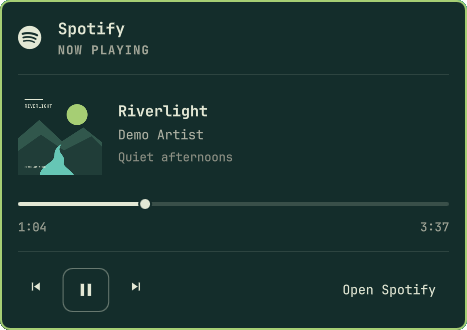

# Spotify Mini for Omarchy

A small, theme-aware Spotify player for the Omarchy bar. A monochrome Spotify
icon appears while the desktop app plays music. Click it for a compact landscape
popup with album artwork, track details, and playback controls.

Uses the desktop app's local MPRIS interface. No separate Spotify login, Web API,
API keys, Spotifyd, or library loading. Spicetify is optional and is not required.

## Preview



The small monochrome indicator fits the native bar:


Screenshots use fictional track metadata and original demo artwork, not a real
listening session. Colors and typography follow the active Omarchy theme.

## Features

- Matches Omarchy's native panels, font scale, colors, icons, and spacing.
- Small album cover alongside track, artist, and album details.
- Previous, play/pause, next, seek slider, elapsed/total time, and Open Spotify.
- Icon hides when Spotify stops playing. An open popup stays visible when paused,
  so you can resume before closing it.
- Middle-click the bar icon to toggle playback.
- Popup shortcuts: **Space** play/pause, **Left/Right** seek five seconds,
  **Tab** focus controls, **Escape** dismiss.
- Unsupported controls are disabled; missing artwork gets a music-note fallback.
- No polling while the popup is closed; its progress display updates once per
  second while open and playing.

## Requirements

- Omarchy 4 (Quattro), with the built-in bar and its `qs.Ui` / `qs.Commons` modules.
- Quickshell with MPRIS support, supplied by Omarchy.
- The Spotify desktop app exposing `org.mpris.MediaPlayer2.spotify` over D-Bus.

The web player and remote devices exposed through KDE Connect are intentionally
excluded. This controls playback on this computer, not your Spotify account's
entire Connect device list. Desktop-app metadata and control availability depend
on the installed Spotify version. Tested on Omarchy with Hyprland 0.56.2.

## Install

```sh
omarchy plugin add https://github.com/LainsMain/omarchy-spotify-mini --enable
```

If you want the icon on the right:

```sh
omarchy plugin enable lainsmain.spotify-mini right
```

Start a track in Spotify. The icon is intentionally absent while nothing is
playing. Install through Omarchy's plugin command; no root permissions or install
scripts are needed.

## Remove

```sh
omarchy plugin remove lainsmain.spotify-mini --yes
```

The plugin creates no account credentials, background services, or caches to
clean up. Spotify and its settings are unaffected.

## Troubleshooting

If the icon does not appear, check that the desktop Spotify app is playing and
that its MPRIS service exists:

```sh
busctl --user list | grep org.mpris.MediaPlayer2.spotify
omarchy-shell lainsmain.spotify-mini status
```

After a manual file edit, `omarchy restart shell` can clear a stale loaded widget.
Theme colors and typography follow Omarchy automatically. Popup controls work on
each monitor; direct IPC commands target the instance registered by the shell.

## Development

```sh
omarchy plugin validate .
node --test tests/model.test.cjs
```

Optional IPC commands: `toggle`, `close`, `playPause`, `seek <seconds>`, and
`status`, all under the `lainsmain.spotify-mini` target. The status output contains
current track metadata, not credentials.

## License and credits

MIT; see [LICENSE](LICENSE). Uses Omarchy's native UI components and panel
conventions, with attribution to Omarchy / David Heinemeier Hansson. The Spotify
icon is a glyph from the system's Nerd Font; no proprietary artwork is bundled.
Not affiliated with Spotify. Spotify is a trademark of its owner.
